<p align="center">
  
</p>

<p align="center">
  A school information system where principals, teachers, parents and students can ask questions about grades and attendance in plain Turkish or English, with access enforced by the database itself.
</p>

<p align="center">
  English · <a href="README.tr.md">Türkçe</a>
</p>

<p align="center">
  <a href="https://smartschoolassistant.com"><b>Live demo</b></a> ·
  <a href="https://smartschoolassistant.com/?sayfa=arastirma">Research report</a> ·
  <a href="https://smartschoolassistant.com/?sayfa=haftalik">Weekly reports</a>
</p>

| Link | What you can do there |
| --- | --- |
| [smartschoolassistant.com](https://smartschoolassistant.com) | Log in with any of the [demo accounts](#demo-accounts) (principal, class teacher, parent or student) and ask questions in Turkish or English. Each role sees different data, so asking the same question from two accounts is the quickest way to see the access rules at work. Principals and class teachers also get the attention flag page. |
| [Research report](https://smartschoolassistant.com/?sayfa=arastirma) | No login needed. The full data science study: the UCI and OULAD analyses, the rule vs. model comparison, the extra analyses with their pre-registered expectations, and the errors found along the way. |
| [Weekly reports](https://smartschoolassistant.com/?sayfa=haftalik) | No login needed. The presentation from every week of the internship, as slides or as a PDF to download. |

---

This project is a demo version of the project I developed during my 12-week internship at **Türksat**. I recorded and uploaded what I did each week separately, with that week's presentation and report. These reports are on the *Weekly reports* page of the app.

Firm's own version control history and its contents stay with the company for security reasons, so I was not able to share real commit history :( To show how the work progressed, I commited weekly snapshots of the code as it was at the end of dedicated week.

The project has two halves:

1. **The school app.** A FastAPI backend and a Streamlit frontend on PostgreSQL. Users log in with one of four roles and can ask questions like *"Which students in my class missed the most days this term?"*. The question is turned into SQL, the SQL is checked, and it runs under PostgreSQL row-level security, so a parent can never see another child's data even if the generated query asks for it.
2. **The research part.** A data science study on two open education datasets (UCI Student Performance and OULAD) asking a practical question: can a simple, explainable classroom rule flag struggling students about as well as a machine learning model? The answer, and the mistakes made on the way, are written up in the research report page.

All school data in the app is synthetic (6 classes, 36 students). No real student data is used anywhere.

## Contents

- [Features](#features)
- [For parents](#for-parents)
- [Architecture](#architecture)
- [How a question is answered](#how-a-question-is-answered)
- [Security model](#security-model)
- [The attention flag](#the-attention-flag)
- [Research: rule vs. model](#research-rule-vs-model)
- [Tech stack](#tech-stack)
- [Project structure](#project-structure)
- [Running locally](#running-locally)
- [Running the research pipeline](#running-the-research-pipeline)
- [Tests](#tests)
- [Deployment](#deployment)
- [Known limitations](#known-limitations)
- [Data sources](#data-sources)

## Features

- **Four roles** with different views of the same data: principal (whole school), class teacher (own class), parent (own child), student (self).
- **Natural-language questions** in Turkish and English. The answer shows the SQL that was actually run, so the user can check where the numbers came from (can be turned off with `SHOW_SQL=false`).
- **Grounded answers.** Every number in an answer must appear in the query results. If the model writes a number that is not there (for example a rounded range like "71–74"), the answer is rejected and the model gets one correction turn.
- **Clean tables for lists.** When someone asks to list records, for example *"List the grades of the students in my class"*, the app draws the full result under the answer: one row per student, one column per exam, with the exam date in the header (`Fizik 29.09`; subject names come from the data). The written answer stays two sentences long whether the class has 6 students or 32 (details in [How a question is answered](#how-a-question-is-answered)).
- **Checking the question, not only answering it.** If a question is built on a wrong assumption, the assistant checks it against the data first. In the screenshot below the principal asks why 9-A is the lowest class; the query shows that 9-A actually has the highest average and a different class is the lowest, and the answer says so instead of explaining a gap that does not exist.
- **Class position for teachers.** A class teacher can ask *"What is my class's rank in our school?"* and gets the class's rank, the number of classes, the class average and the school average. Other classes' names and averages are never returned, and the answer points out that classes are at different grade levels, so the rank says nothing about the teacher.
- **Attention flags** for principals and class teachers: a within-class rule that combines grade average and unexcused absences, with a plain-language reason for each flagged student and no hidden score.
- **Term-aware questions.** "This term" and "now" are resolved against the school calendar, and the answer says so when the data only covers part of the period.
- **Public research report** (no login) with the full analysis, figures in both languages and a section on what went wrong.
- **Weekly reports page** with all internship presentations as slides and downloadable PDFs.
- **Turkish and English UI**, switchable on every page.

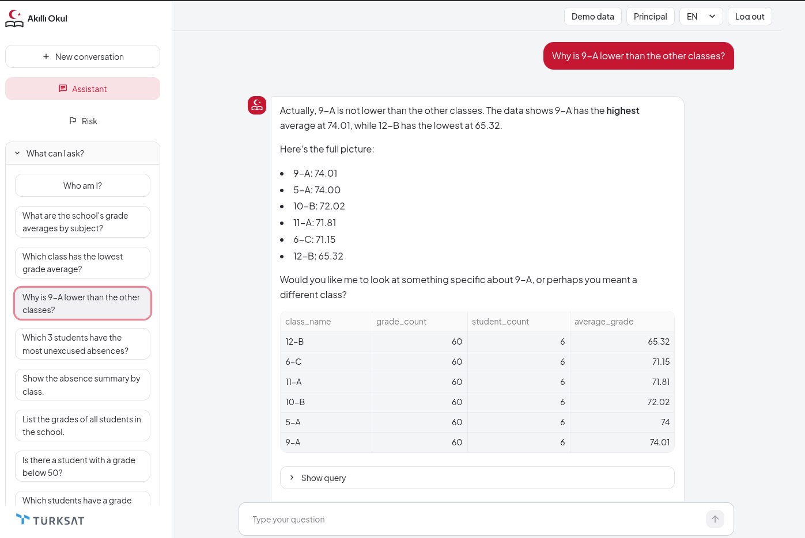

## For parents

Keeping parents informed about their own child was one of the main goals of the project, so the parent role is more than a filtered view of the database.

A parent can only see information about their own child. They can still ask comparative questions such as *"Where is my daughter in her class in math?"*. These are answered through `student_rank`: the function returns the child's position, the number of students and the class or school average, without showing any other child's grades.

Many questions parents ask are not about numbers at all: *"How can I help my son enjoy math?"*, *"My child doesn't want to go to school anymore."* The assistant has separate rules for these:

- For study and support questions it gives short, general advice tied to the real data, for example starting from the subject where the child's average is lowest, and suggests talking to the teacher.
- For emotional or behavioural topics (not liking school, anxiety, unhappiness) the first answer does not open with grades or absences. It gives a sentence of understanding, two or three open questions the parent can ask at home, a suggestion to talk to the school counsellor, and an offer to look at the grades together if the parent wants.
- It does not diagnose, does not predict the child's future, does not make promises, and does not claim that grades or absences caused a feeling.
- When the user is a student, it speaks to them directly and suggests talking to their family or someone they trust.

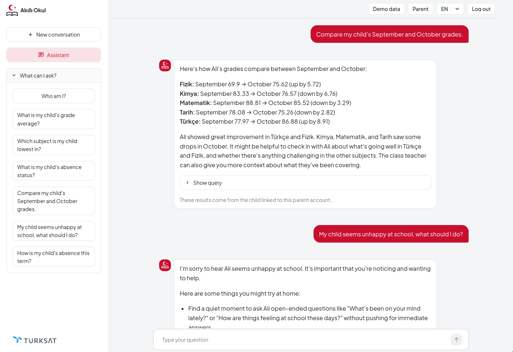

## Architecture

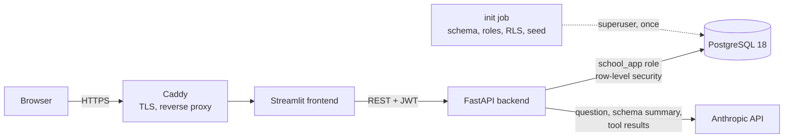

Everything runs in Docker Compose on a single VPS. Only Caddy is exposed to the internet; the backend, frontend and database are reachable only inside the Compose network. The backend and frontend share one image (`python:3.14.9-slim`, installed from the lock file, running as a non-root user).

There are two database connections on purpose:

- `DATABASE_URL` is a superuser connection. It is only used by the setup scripts and for building the schema summary.
- `APP_DATABASE_URL` is the `school_app` role (`NOSUPERUSER`, `NOBYPASSRLS`). Every user request goes through this one.

## How a question is answered

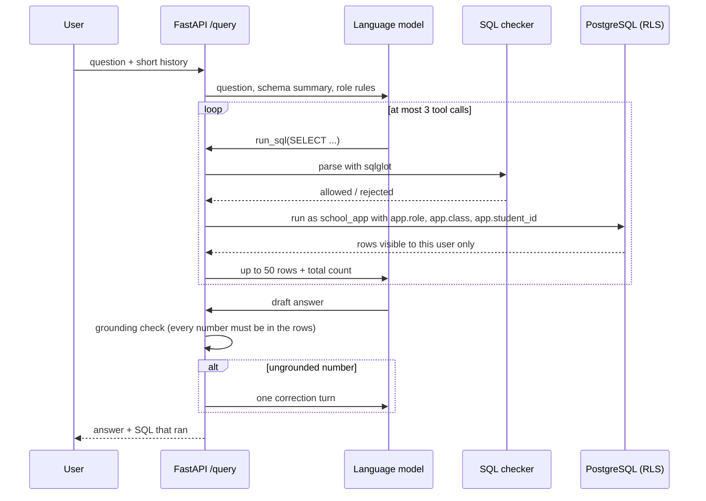

A few limits that are fixed in code:

- At most 3 `run_sql` calls per question (one extra is allowed only in a correction turn).
- The database stops at 500 rows and a statement timeout; the model sees at most 50 rows plus the total count.
- The chat history sent back is cut to the last 6 messages, 600 characters each, and only `user` and `assistant` entries are accepted.
- `/query` allows 10 requests per user per 60 seconds.

**List requests.** `run_sql` has a `presentation` option. For questions like *"list my students' grades"* the model sets it to `table`. In that mode the model does not receive any rows, only a summary computed from the whole result: the number of records, the number of distinct students and subjects, and the date span. The app then shows the complete result as a table under the answer. I added this after noticing that for a 60-row result the model saw only the first 50 rows and wrote out a list that silently left one student out. Now the model cannot drop or change rows, because it never sees them, and a class of 32 students gets the same short answer as a class of 6.

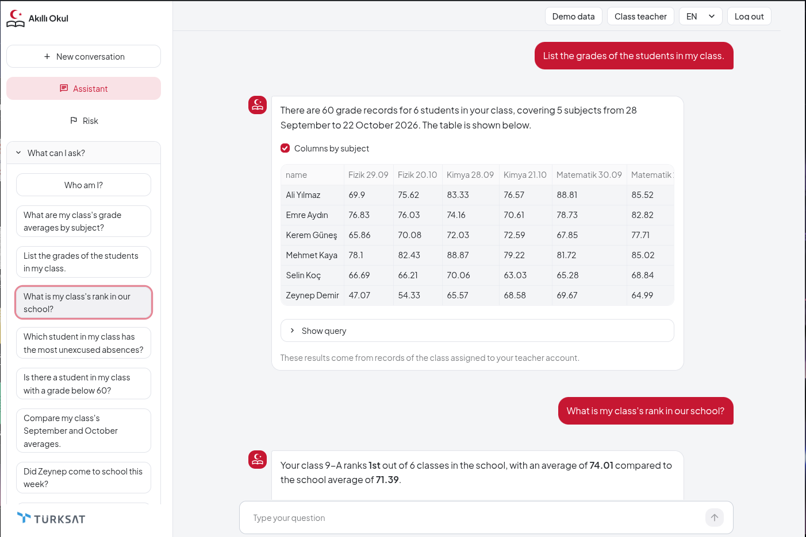

Principals and class teachers also get a `get_risk` tool, which calls the same code as the attention flag page instead of re-implementing it. A class teacher asking about another class gets a refusal, and the refusal is logged. Parents and students do not have the tool at all.

## Security model

The main idea is that the language model is not trusted. It can write any SQL it wants; the system has to stay safe anyway.

| Threat | Where it stops |
| --- | --- |
| Changing `app.role` with `set_config` inside a SELECT | Function allow-list in the SQL checker; the query never reaches the database |
| `pg_sleep`, `pg_ls_dir`, `lo_*`, `dblink`, `current_setting` | Same allow-list |
| Reading `users` or any other table | Table allow-list (`students`, `grades`, `attendance`) |
| A parent or student reading another student's rows | PostgreSQL row-level security on all three tables |
| Using `student_rank`, `class_teacher` or `class_rank` to look up someone else | No student id parameter; `SECURITY DEFINER` with fixed `search_path`; no `EXECUTE` for `PUBLIC` |
| Finding out which usernames exist from login errors | bcrypt check runs even for unknown users; same 401 body |
| Password guessing | 5 failed logins per username per minute, then 429 |
| Database error text leaking to the user or the model | Generic tool error; raw text only goes to the server log |

Each row has tests behind it; the full table with test file names is in [`docs/SECURITY.md`](docs/SECURITY.md).

A class teacher has the same problem one level up: the tables only hold their own class, so a school average written in plain SQL would really be their class average. `class_rank` works like `student_rank` for classes. It reads the class from the session, not from a parameter, and returns one row with the class's rank, the number of classes, the class average and the school average.

Parent and student accounts only see one student, so a plain `AVG` over their rows describes only that child. When such a query runs, the tool result carries a `scope_warning`, and class or school comparisons have to come from `student_rank`, which returns aggregates without exposing other students.

## The attention flag

The risk page does not predict anything. Inside each class it:

1. computes each student's grade average and number of unexcused absences,
2. turns both into within-class percentile ranks (low grades and many absences rank as higher concern),
3. averages the two ranks,
4. flags the top 20% of the class (rounded up).

Every flagged row comes with a sentence explaining why, for example the student's rank in the class for grades and for absences. The output never contains a score or a probability; the code raises an error if such a field ever appears. A flag is meant to start a conversation with the class teacher, not to make a decision.

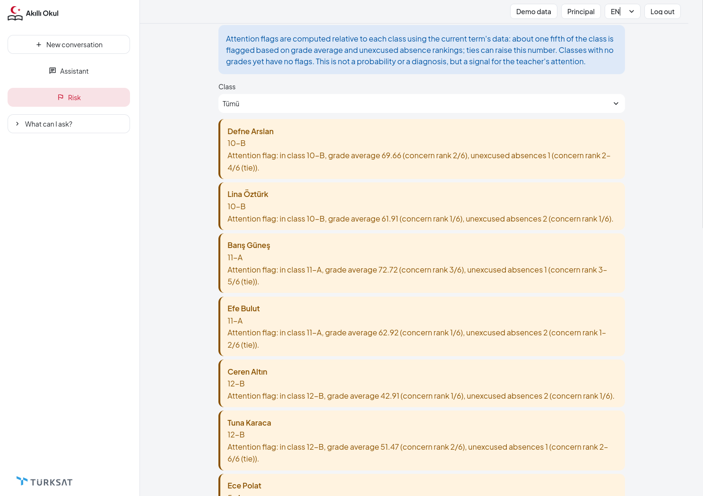

Why a rule and not a model? That is what the research part tests.

## Research: rule vs. model

The school demo data is synthetic, so the question was studied on open data instead.

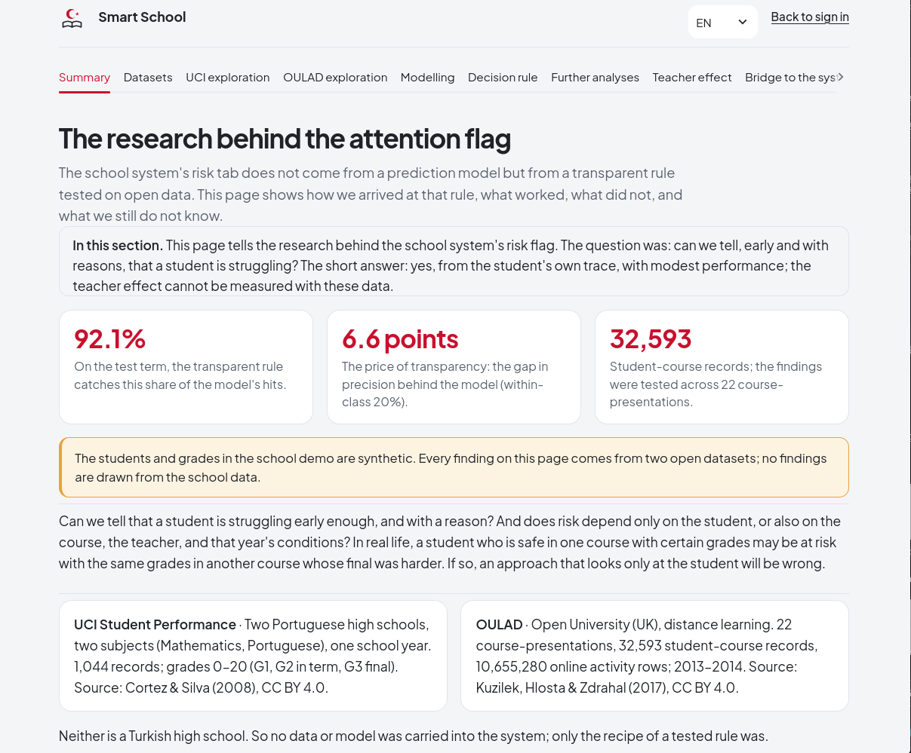

**UCI Student Performance** (two Portuguese secondary schools, 1,044 student records in math and Portuguese) was used for exploration. One result that shaped the app: absences alone are a weak signal for the final grade (Spearman ρ = −0.11 overall, −0.24 after excluding the 53 students with a final grade of 0, who look like dropouts rather than low scorers).

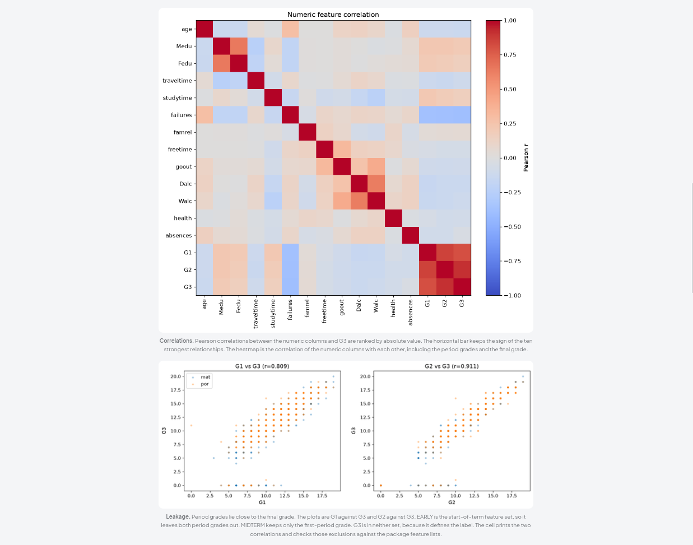

**OULAD** (Open University Learning Analytics Dataset, 22 module presentations, about 10.6 million learning platform activity rows) was used for modelling. The setup:

- The prediction is made on **day 60** of the course, using only what is known by then: assessment scores, unsubmitted assignments, learning platform activity and course history.
- A student counts as positive if they end up failing or withdrawing. Students who had already unregistered before day 60 are left out.
- Splits are by time: trained on 2013J, validated on 2014B, and tested **once** on 2014J.
- Models: logistic regression and histogram gradient boosting, on five feature sets.

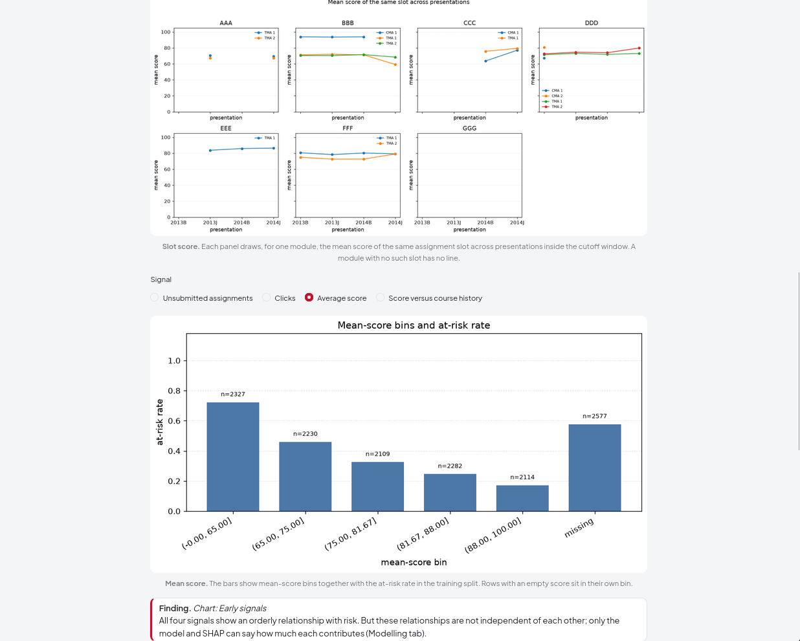

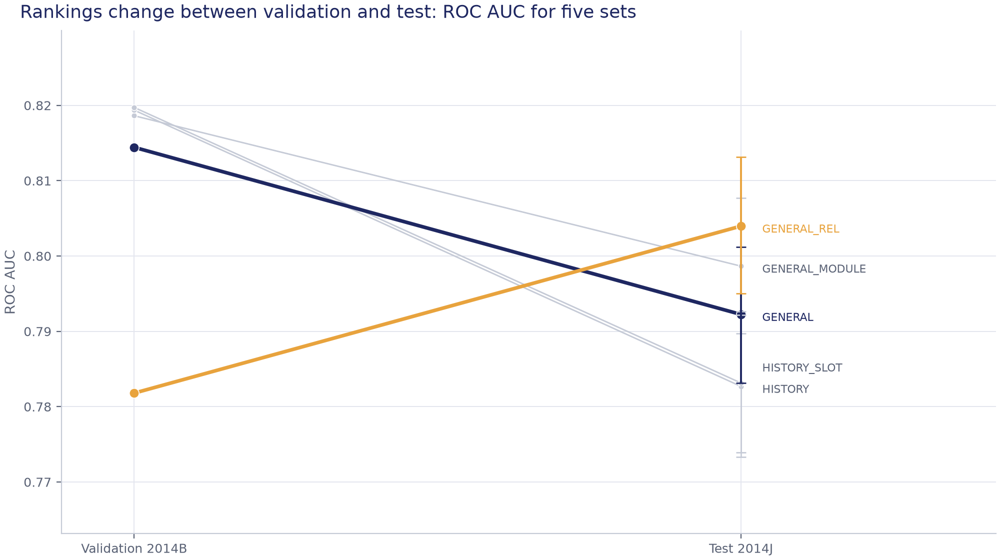

*The best feature set on validation was not the best on test. Choosing a model by validation score alone would have been misleading here, which is why the report keeps all five.*

The main comparison puts the fixed rule and the model under the same capacity: each flags 20% of students inside every module, on the 2014J test term.

| Method | Students | Flagged | Correct flags | Precision |
| --- | ---: | ---: | ---: | ---: |
| Fixed rule (unsubmitted work, score, active days) | 8,140 | 1,630 | 1,283 | 0.787 |
| Gradient boosting model | 8,140 | 1,630 | 1,352 | 0.829 |

The model is better, but not by much: about 4 percentage points, or 69 more correct flags out of 1,630. Overall, the gradient boosting model reaches a test ROC AUC of 0.792 (95% CI 0.783–0.801). The results are modest and the report presents them that way.

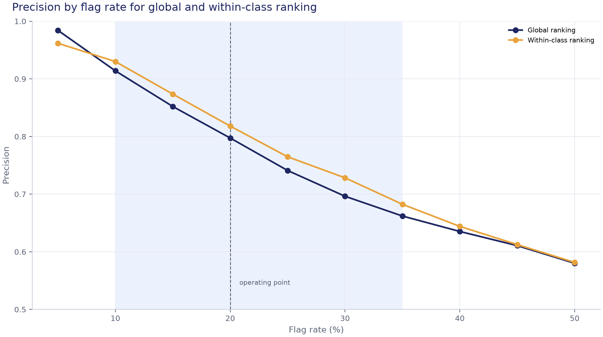

*Ranking students within their own class is slightly more precise than ranking everyone together at the 20% operating point, which supports the within-class design of the app's flag.*

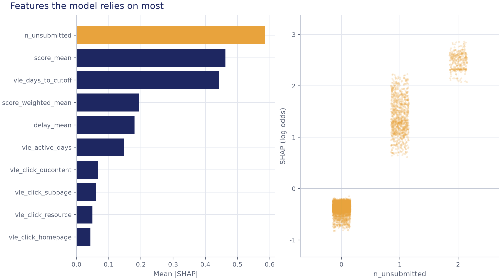

*The strongest feature is the number of unsubmitted assignments. SHAP shows what the model uses, not what causes failure.*

After the main study I ran four extra analyses with expectations written down beforehand; the expectation files were hashed with md5 before the runs (`docs/on_kayit_md5.txt`). Of ten expectations, 5 held, 3 did not and 2 were unclear. The most interesting result went against my starting guess: at day 60 it is easier to find students who will stay and fail than students who will withdraw, by about 0.04 ROC AUC in both terms. Grades and submissions together come within 0.011–0.017 ROC AUC of the full model without any activity data, which matters for a school that does not have a learning platform.

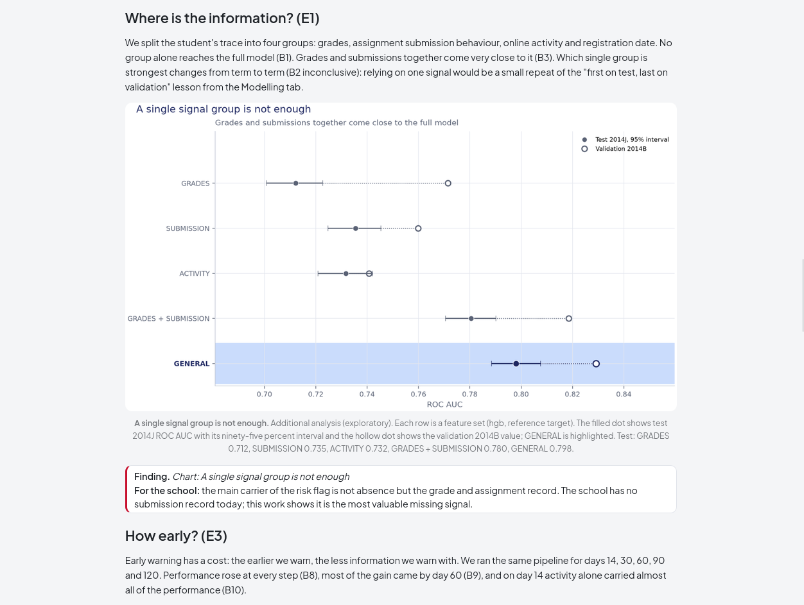

What this means for the school app: there is currently no record of unsubmitted homework in the school data, and the study suggests it would be the most valuable signal to add.

The full write-up, with all figures in Turkish and English and a section on errors found and fixed during the work, is on the [research report page](https://smartschoolassistant.com/?sayfa=arastirma). The notebooks are in `notebooks/` (Turkish and `_eng` versions), with HTML exports in `notebooks/html/`.

## Tech stack

| Layer | Tools |
| --- | --- |
| Backend | Python 3.14, FastAPI, SQLAlchemy 2, Pydantic Settings, python-jose (JWT), passlib + bcrypt |
| SQL checking | sqlglot |
| Database | PostgreSQL 18 with row-level security, `SECURITY DEFINER` functions |
| Assistant | Anthropic API with tool use |
| Frontend | Streamlit, custom CSS theme |
| Data science | pandas, NumPy, scikit-learn, SHAP, matplotlib, pyarrow, Jupyter |
| Deployment | Docker Compose, Caddy (automatic HTTPS), Contabo VPS, Cloudflare DNS |
| Testing | pytest |

## Project structure

```text
.
├── backend/
│   ├── app/
│   │   ├── api/          # /login, /query, /assistant/examples, /risk
│   │   ├── core/         # JWT, SQL checker, RLS context, rate limiter, logging
│   │   ├── models/       # SQLAlchemy models
│   │   └── services/     # assistant loop, attention flag, schema summary, calendar
│   └── tests/
├── frontend/
│   ├── app.py            # login, assistant, risk page, routing
│   ├── arastirma.py      # research report page
│   ├── haftalik.py       # weekly reports page
│   ├── i18n.py           # Turkish / English strings
│   ├── assets/           # logos, research figures, weekly slides
│   └── tests/
├── database/
│   ├── init_db.py        # create tables
│   ├── bootstrap_roles.py# school_app role, grants, base policies
│   ├── enable_rls.py     # RLS policies and SECURITY DEFINER functions
│   ├── seed_mock.py      # load the synthetic school data
│   ├── mock_data.json
│   └── ref/              # schema and roles dumped from the reference database
├── data_science/
│   ├── download.py, eda.py, features.py    # UCI part
│   └── oulad/            # OULAD loading, features, models, rule, SHAP, extra analyses, figures
├── notebooks/            # 01 UCI EDA, 02 OULAD EDA, 03 OULAD model (TR + EN)
├── scripts/              # research package builder, weekly slide export, mock data generator
├── eval/                 # end-to-end evaluation of the assistant
├── config/settings.py
├── docs/                 # deployment, security, research specs, pre-registration files
├── tests/                # data science tests
├── Dockerfile
├── docker-compose.yml
├── Caddyfile
└── requirements.lock.txt
```

## Running locally

You need Python 3.14 and PostgreSQL 18. An Anthropic API key is only needed for the assistant; login, the risk page and the research page work without it.

```bash
git clone https://github.com/beraerr/smart_school_assistant.git
cd smart_school_assistant

python3.14 -m venv .venv
.venv/bin/python -m pip install -r requirements.lock.txt

cp .env.example .env
# Fill in .env: SECRET_KEY, DATABASE_URL (superuser), APP_DATABASE_URL (school_app),
# ANTHROPIC_API_KEY, LLM_MODEL. Optionally DEMO_TODAY=2026-11-09 to match the demo.
```

Create an empty database, point `DATABASE_URL` at it, then run the setup scripts in this order:

```bash
.venv/bin/python database/init_db.py
.venv/bin/python database/bootstrap_roles.py
.venv/bin/python database/enable_rls.py
.venv/bin/python database/seed_mock.py
```

The first three can be run again safely. `seed_mock.py` empties the tables and reloads them every time.

Start the backend and the frontend in two terminals:

```bash
.venv/bin/python -m uvicorn backend.app.main:app --port 8000
.venv/bin/python -m streamlit run frontend/app.py
```

The app opens at `http://localhost:8501`.

### Demo accounts

The same accounts work on the live demo. They are demo-only and intentionally public.

| Role | Username | Password | Sees |
| --- | --- | --- | --- |
| Principal | `principal` | `admin123` | Whole school |
| Class teacher | `teacher1` | `teacher123` | Class 9-A |
| Class teacher | `teacher2` | `teacher123` | Class 10-B |
| Parent | `parent1` | `parent123` | Own child |
| Student | `student1` | `student123` | Own records |

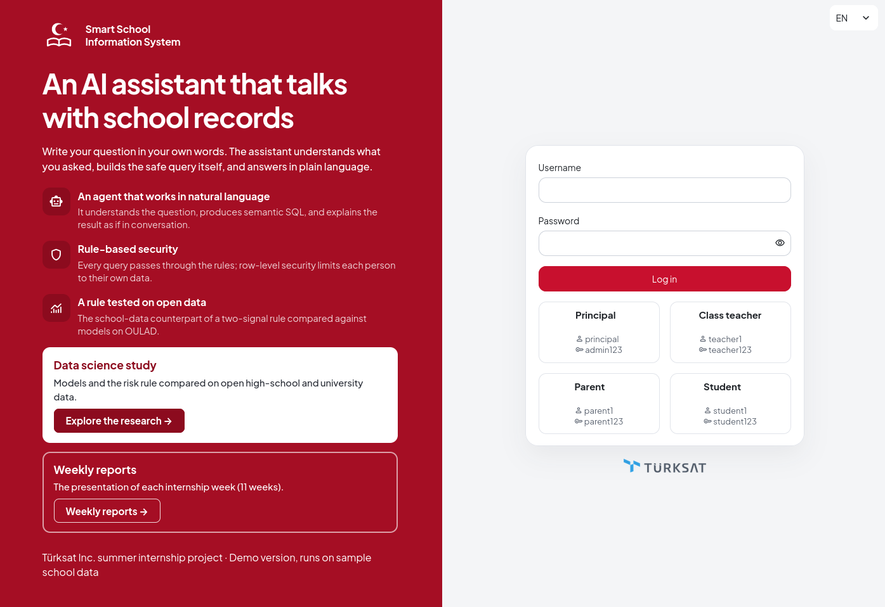

## Running the research pipeline

The raw datasets are not in the repository (the OULAD activity file alone is about 450 MB). The download scripts fetch them from the UCI repository and check them against stored SHA-256 values.

```bash
# UCI Student Performance
.venv/bin/python -m data_science.download
.venv/bin/python -m data_science.eda

# OULAD: download, daily activity table, day-60 features, models, rule, SHAP
.venv/bin/python -m data_science.oulad.download
.venv/bin/python -m data_science.oulad.vle
.venv/bin/python -m data_science.oulad.dataset
.venv/bin/python -m data_science.oulad.model
.venv/bin/python -m data_science.oulad.rule
.venv/bin/python -m data_science.oulad.explain
.venv/bin/python -m data_science.oulad.ek          # extra analyses (add --e3 for the third one)
.venv/bin/python -m data_science.oulad.figures

# Rebuild the package the research page reads
.venv/bin/python scripts/arastirma_paketi.py
```

The research page only reads `frontend/assets/arastirma/arastirma.json` and the figure files. Every number on the page comes from that package; there are no hand-typed figures in the page text, and tests check this.

## Tests

```bash
.venv/bin/python -m pytest -q
```

There are a little over 1,300 tests. They cover the SQL checker, row-level security, the assistant loop (with a fake model, so no API calls are made), the grounding check, the attention flag, the research package and both UI pages.

Some backend tests run against the local PostgreSQL database from the setup above. Tests that need the raw research data are skipped when it is not on disk.

## Deployment

The live demo runs on a Contabo VPS with Docker Compose:

| Service | Role |
| --- | --- |
| `db` | PostgreSQL 18.6, data in a named volume, not exposed |
| `init` | One-off job (profile `init`): tables, roles, RLS, seed |
| `backend` | Uvicorn, health-checked |
| `frontend` | Streamlit |
| `caddy` | The only public service, ports 80/443, automatic certificates |

The `.env` file exists only on the server and is excluded from both the image and the repository. The step-by-step guide is in [`docs/DEPLOY.md`](docs/DEPLOY.md) (in Turkish).

On the demo, the date is fixed at 9 November 2026 (`DEMO_TODAY`) so that the synthetic term data and the "this term" answers stay consistent.

## Known limitations

- Rate limits are kept in process memory: they are not shared between workers and reset on restart.
- The demo is public and anyone can log in with any role, including principal.
- The assistant sends the question, a schema summary and query results to an external API. With real student data this would need a KVKK / GDPR review first.
- The attention flag uses grades and absences only. The research suggests unsubmitted homework would be a stronger signal, but the school data model has no such record yet.
- The research results come from a UK distance-learning university and Portuguese secondary schools. They show what worked on those datasets, not what will work in a Turkish school.

## Data sources

- P. Cortez and A. Silva, *Using Data Mining to Predict Secondary School Student Performance*, 2008. [UCI Student Performance dataset](https://archive.ics.uci.edu/dataset/320/student+performance), CC BY 4.0.
- J. Kuzilek, M. Hlosta and Z. Zdrahal, *Open University Learning Analytics dataset*, Scientific Data 4, 2017. [OULAD on UCI](https://archive.ics.uci.edu/dataset/349/open+university+learning+analytics+dataset), CC BY 4.0.

---

Ensar Bera Ergin · Computer Science, Polish-Japanese Academy of Information Technology (PJAIT), Warsaw · [GitHub](https://github.com/beraerr)
