<p align="center">
  
</p>

<p align="center">
  Müdür, öğretmen, veli ve öğrencilerin not ve devamsızlık verisine Türkçe ya da İngilizce soru sorabildiği, erişimin doğrudan veritabanı tarafından denetlendiği bir okul bilgi sistemi.
</p>

<p align="center">
  <a href="README.md">English</a> · Türkçe
</p>

<p align="center">
  <a href="https://smartschoolassistant.com"><b>Canlı demo</b></a> ·
  <a href="https://smartschoolassistant.com/?sayfa=arastirma">Araştırma raporu</a> ·
  <a href="https://smartschoolassistant.com/?sayfa=haftalik">Haftalık raporlar</a>
</p>

| Bağlantı | Orada neler yapılabilir |
| --- | --- |
| [smartschoolassistant.com](https://smartschoolassistant.com) | [Demo hesaplarından](#demo-hesapları) biriyle (müdür, sınıf öğretmeni, veli veya öğrenci) giriş yapıp Türkçe ya da İngilizce soru sorabilirsiniz. Her rol farklı veriyi görüyor; aynı soruyu iki ayrı hesaptan sormak, erişim kurallarını iş başında görmenin en hızlı yolu. Müdür ve sınıf öğretmeni ayrıca dikkat bayrağı sayfasını görüyor. |
| [Araştırma raporu](https://smartschoolassistant.com/?sayfa=arastirma) | Giriş gerekmez. Veri bilimi çalışmasının tamamı: UCI ve OULAD analizleri, kural ile modelin karşılaştırması, önceden kayda geçirilmiş beklentileriyle ek analizler ve yol boyunca bulunan hatalar. |
| [Haftalık raporlar](https://smartschoolassistant.com/?sayfa=haftalik) | Giriş gerekmez. Stajın her haftasının sunumu; slayt olarak ya da indirilebilir PDF. |

---

Bu proje **Türksat**'taki 12 haftalık stajım sırasında geliştirdiğim projenin bir demo versiyonu. Her hafta yaptıklarımı, o haftanın sunumları ve raporları ile ayrı ayrı kaydedip yükledim. Bu raporlar uygulamada *Haftalık raporlar* sayfasında duruyor.

Staj yerinin kendi sürüm kontrol sistemi ve içeriği güvenlik nedeniyle kurum içinde kalıyor; bu yüzden asıl commit geçmişini bulamayabilirsiniz :( Çalışmanın nasıl ilerlediğini yine de gösterebilmek için bu repodaki geçmiş, stajın sonunda kodun haftalık anlık görüntülerinden oluşturuldu: her `week-NN` etiketi kodun o haftanın sonundaki hâli. GitHub'da herhangi iki haftayı karşılaştırabilirsiniz (örneğin `week-06...week-07`).

Proje iki parçadan oluşuyor:

1. **Okul uygulaması.** PostgreSQL üzerinde bir FastAPI backend ve bir Streamlit arayüzü. Kullanıcılar dört rolden biriyle giriş yapıp *"Sınıfımda bu dönem en çok devamsızlık yapan öğrenciler kimler?"* gibi sorular sorabiliyor. Soru SQL'e çevriliyor, SQL denetleniyor ve PostgreSQL satır düzeyi güvenliği (RLS) altında çalıştırılıyor. Böylece üretilen sorgu ne isterse istesin bir veli başka bir öğrencinin verisini göremiyor.
2. **Araştırma bölümü.** İki açık eğitim veri seti (UCI Student Performance ve OULAD) üzerinde pratik bir soruya bakan bir veri bilimi çalışması: Basit ve açıklanabilir bir sınıf içi kural, zorlanan öğrencileri bir makine öğrenmesi modeli kadar iyi işaretleyebilir mi? Cevap ve yol boyunca yapılan hatalar araştırma raporu sayfasında anlatılıyor.

Uygulamadaki tüm okul verisi sentetiktir (6 sınıf, 36 öğrenci). Hiçbir yerde gerçek öğrenci verisi kullanılmadı.

## İçindekiler

- [Özellikler](#özellikler)
- [Veliler için](#veliler-için)
- [Mimari](#mimari)
- [Bir soru nasıl cevaplanıyor](#bir-soru-nasıl-cevaplanıyor)
- [Güvenlik modeli](#güvenlik-modeli)
- [Dikkat bayrağı](#dikkat-bayrağı)
- [Araştırma: kural ve model](#araştırma-kural-ve-model)
- [Kullanılan teknolojiler](#kullanılan-teknolojiler)
- [Proje yapısı](#proje-yapısı)
- [Yerelde çalıştırma](#yerelde-çalıştırma)
- [Araştırma hattını çalıştırma](#araştırma-hattını-çalıştırma)
- [Testler](#testler)
- [Yayına alma](#yayına-alma)
- [Bilinen sınırlamalar](#bilinen-sınırlamalar)
- [Veri kaynakları](#veri-kaynakları)

## Özellikler

- **Dört rol**, aynı verinin farklı görünümleri: müdür (tüm okul), sınıf öğretmeni (kendi sınıfı), veli (kendi çocuğu), öğrenci (kendisi).
- **Doğal dilde sorular**, Türkçe ve İngilizce. Cevabın altında gerçekten çalıştırılan SQL gösteriliyor, böylece kullanıcı sayıların nereden geldiğini kontrol edebiliyor (`SHOW_SQL=false` ile kapatılabilir).
- **Dayanaklı cevaplar.** Cevaptaki her sayının sorgu sonucunda geçmesi gerekiyor. Model sonuçta olmayan bir sayı yazarsa (örneğin "71-74" gibi yuvarlanmış bir aralık), cevap reddediliyor ve modele bir düzeltme turu veriliyor.
- **Listeler için düzgün tablolar.** Biri kayıtları listelemek istediğinde, örneğin *"Sınıfımdaki öğrencilerin notlarını listele"*, uygulama sonucun tamamını cevabın altında tablo olarak çiziyor: her öğrenci bir satır, her sınav bir sütun, sınav tarihi başlıkta (`Fizik 29.09`). Sınıfta 6 öğrenci de olsa 32 öğrenci de olsa yazılı cevap iki cümleyi geçmiyor (ayrıntısı [Bir soru nasıl cevaplanıyor](#bir-soru-nasıl-cevaplanıyor) bölümünde).
- **Yalnızca cevaplamak değil, soruyu da kontrol etmek.** Soru yanlış bir varsayıma dayanıyorsa asistan önce bunu veriyle kontrol ediyor. Aşağıdaki ekran görüntüsünde müdür 9-A'nın neden en düşük sınıf olduğunu soruyor; sorgu 9-A'nın aslında en yüksek ortalamaya sahip olduğunu ve en düşük sınıfın başka bir sınıf olduğunu gösteriyor. Cevap, var olmayan bir farkı açıklamaya çalışmak yerine bunu söylüyor.
- **Öğretmen için sınıfın okuldaki yeri.** Sınıf öğretmeni *"Sınıfım okulda kaçıncı?"* diye sorabiliyor ve sınıfın sırasını, sınıf sayısını, sınıf ortalamasını ve okul ortalamasını alıyor. Başka sınıfların adı ve ortalaması hiçbir zaman dönmüyor. Cevap ayrıca sınıfların farklı düzeylerde olduğunu, bu yüzden sıranın öğretmen hakkında bir şey söylemediğini belirtiyor.
- **Dikkat bayrakları**, müdür ve sınıf öğretmeni için: not ortalamasını ve mazeretsiz devamsızlığı birleştiren sınıf içi bir kural. İşaretlenen her öğrenci için düz bir gerekçe cümlesi var, gizli bir skor yok.
- **Döneme duyarlı sorular.** "Bu dönem" ve "şu an" okul takvimine göre çözülüyor; veri dönemin yalnızca bir kısmını kapsıyorsa cevap bunu söylüyor.
- **Herkese açık araştırma raporu** (giriş gerekmez): analizin tamamı, iki dilde figürler ve neyin yanlış gittiğini anlatan bir bölüm.
- **Haftalık raporlar sayfası**: tüm staj sunumları slayt olarak ve indirilebilir PDF olarak.
- **Türkçe ve İngilizce arayüz**, her sayfada değiştirilebilir.

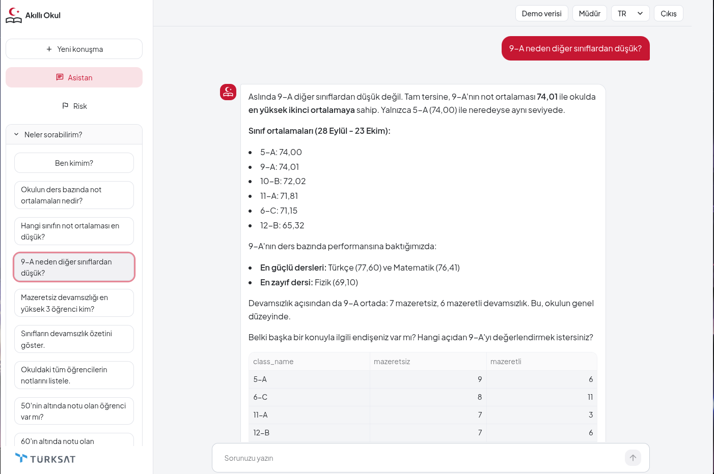

## Veliler için

Velinin kendi çocuğu hakkında bilgi alabilmesi projenin ana hedeflerinden biriydi. Bu yüzden veli rolü, veritabanının süzülmüş bir görünümünden ibaret değil.

Veli yalnızca kendi çocuğuna ait bilgileri görebiliyor. Yine de *"Kızım matematikte sınıfında kaçıncı?"* gibi kıyas soruları sorabiliyor. Bu sorular `student_rank` üzerinden cevaplanıyor: Fonksiyon çocuğun sırasını, öğrenci sayısını ve sınıf ya da okul ortalamasını döndürüyor, başka hiçbir çocuğun notunu göstermiyor.

Velilerin sorduğu soruların çoğu sayılarla ilgili değil: *"Oğluma matematiği nasıl sevdirebilirim?"*, *"Çocuğum artık okula gitmek istemiyor."* Asistanın bunlar için ayrı kuralları var:

- Ders çalışma ve destek sorularında gerçek veriye bağlı, kısa ve genel öneriler veriyor; örneğin çocuğun ortalamasının en düşük olduğu dersten başlamayı ve öğretmenle konuşmayı öneriyor.
- Duygusal veya davranışsal konularda (okulu sevmeme, kaygı, mutsuzluk) ilk cevap notlarla ya da devamsızlıkla açılmıyor. Bir anlayış cümlesi, evde sorulabilecek iki üç açık uçlu soru, okulun rehber öğretmeniyle görüşme önerisi ve veli isterse notlara birlikte bakma teklifi veriyor.
- Tanı koymuyor, çocuğun geleceği hakkında tahmin yürütmüyor, söz vermiyor ve bir duygunun nedeni olarak notları veya devamsızlığı göstermiyor.
- Kullanıcı öğrenciyse ona doğrudan hitap ediyor ve ailesiyle ya da güvendiği biriyle konuşmasını öneriyor.

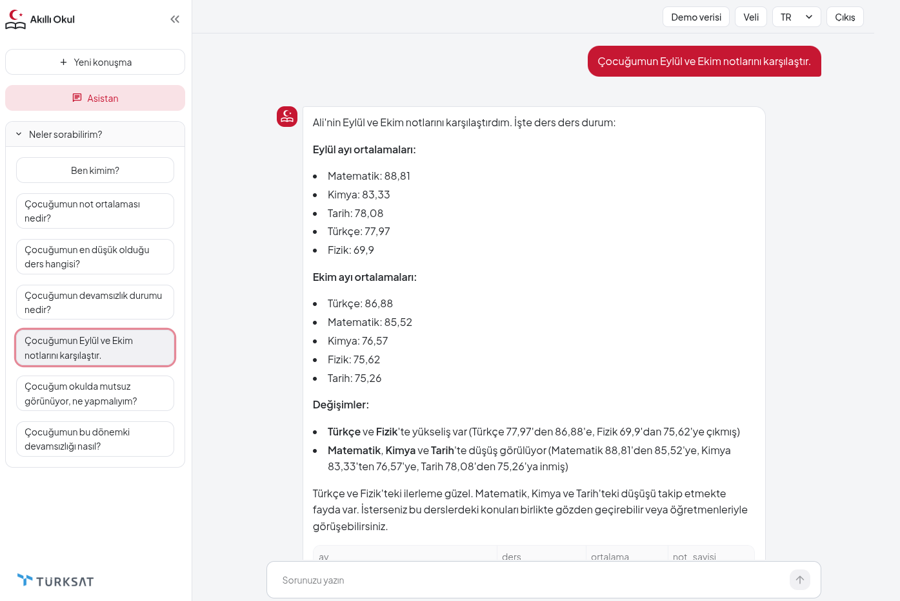

## Mimari

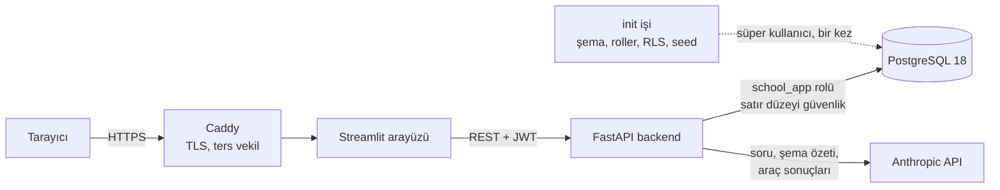

Her şey tek bir VPS üzerinde Docker Compose ile çalışıyor. İnternete yalnızca Caddy açık; backend, arayüz ve veritabanına yalnızca Compose ağının içinden erişilebiliyor. Backend ve arayüz aynı imajı kullanıyor (`python:3.14.9-slim`, bağımlılıklar kilit dosyasından kuruluyor, root olmayan kullanıcıyla çalışıyor).

Bilinçli olarak iki ayrı veritabanı bağlantısı var:

- `DATABASE_URL` süper kullanıcı bağlantısı. Yalnızca kurulum betiklerinde ve şema özetini oluştururken kullanılıyor.
- `APP_DATABASE_URL` ise `school_app` rolü (`NOSUPERUSER`, `NOBYPASSRLS`). Her kullanıcı isteği bu bağlantıdan geçiyor.

## Bir soru nasıl cevaplanıyor

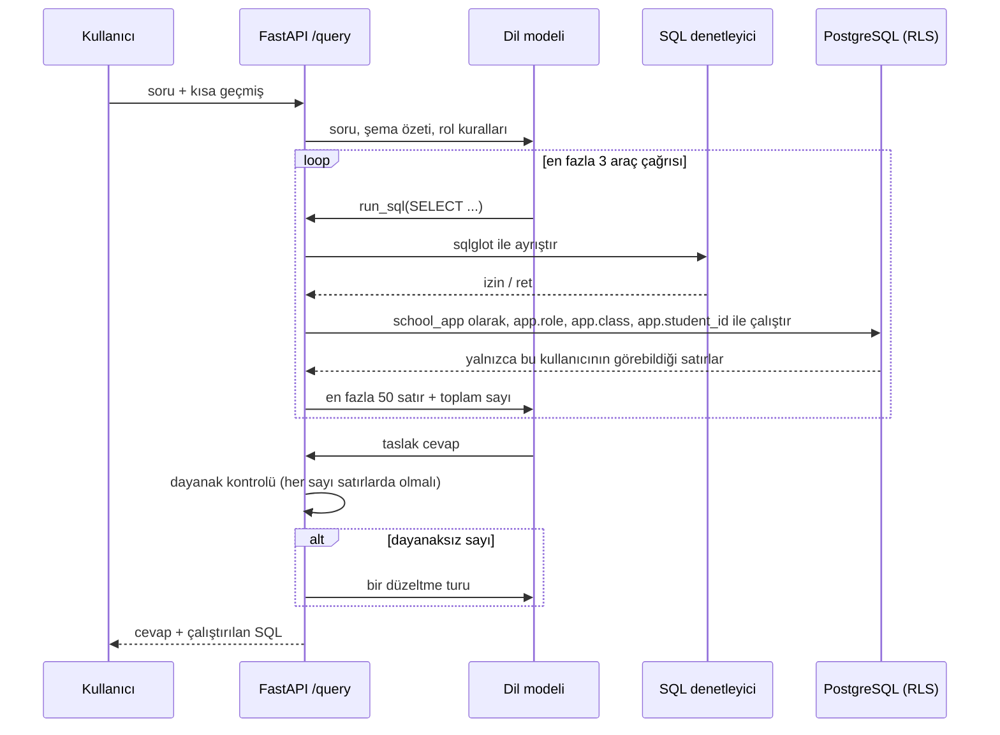

Kodda sabit olan birkaç sınır:

- Soru başına en fazla 3 `run_sql` çağrısı (yalnızca düzeltme turunda bir ek çağrıya izin var).
- Veritabanı 500 satırda ve bir sorgu zaman aşımında duruyor; model en fazla 50 satır ve toplam sayıyı görüyor.
- Geri gönderilen sohbet geçmişi son 6 mesaja, her biri 600 karaktere kırpılıyor; yalnızca `user` ve `assistant` girdileri kabul ediliyor.
- `/query` kullanıcı başına 60 saniyede 10 isteğe izin veriyor.

**Listeleme istekleri.** `run_sql` aracının bir `presentation` seçeneği var. *"Öğrencilerimin notlarını listele"* gibi sorularda model bunu `table` olarak ayarlıyor. Bu modda modele hiç satır gitmiyor; yalnızca sonucun tamamından hesaplanan bir özet gidiyor: kayıt sayısı, farklı öğrenci ve ders sayısı, tarih aralığı. Uygulama da sonucun tamamını cevabın altında tablo olarak gösteriyor. Bunu, 60 satırlık bir sonuçta modelin yalnızca ilk 50 satırı görüp bir öğrenciyi sessizce atlayan bir liste yazdığını fark ettikten sonra ekledim. Artık model satır atlayamıyor ya da değiştiremiyor, çünkü satırları hiç görmüyor; 32 kişilik bir sınıf da 6 kişilik bir sınıfla aynı kısa cevabı alıyor.

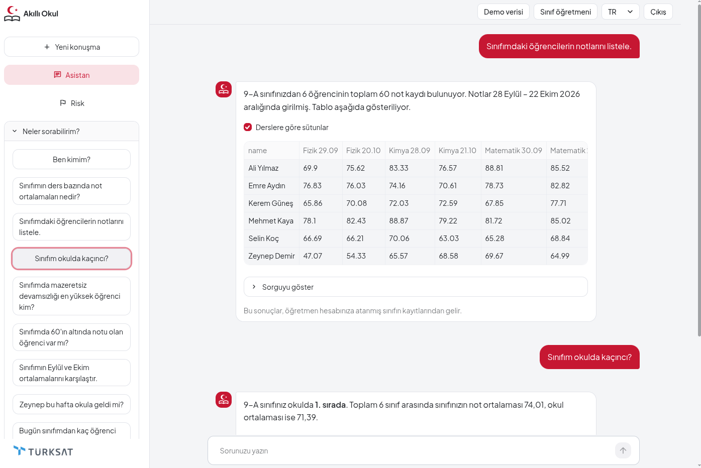

Müdür ve sınıf öğretmeninin bir de `get_risk` aracı var. Bu araç hesabı yeniden yazmak yerine dikkat bayrağı sayfasıyla aynı kodu çağırıyor. Başka bir sınıfı soran sınıf öğretmeni ret alıyor ve ret loglanıyor. Veli ve öğrencide bu araç hiç yok.

## Güvenlik modeli

Temel fikir şu: Dil modeline güvenilmiyor. Model istediği SQL'i yazabilir; sistemin yine de güvenli kalması gerekiyor.

| Tehdit | Nerede duruyor |
| --- | --- |
| Bir SELECT içinde `set_config` ile `app.role`'ü değiştirmek | SQL denetleyicideki fonksiyon izin listesi; sorgu veritabanına hiç ulaşmıyor |
| `pg_sleep`, `pg_ls_dir`, `lo_*`, `dblink`, `current_setting` | Aynı izin listesi |
| `users` ya da başka bir tabloyu okumak | Tablo izin listesi (`students`, `grades`, `attendance`) |
| Veli veya öğrencinin başka bir öğrencinin satırlarını okuması | Üç tabloda da PostgreSQL satır düzeyi güvenliği |
| `student_rank`, `class_teacher` veya `class_rank` ile başkasını sorgulamak | Öğrenci kimliği parametresi yok; sabit `search_path` ile `SECURITY DEFINER`; `PUBLIC` için `EXECUTE` yok |
| Giriş hatalarından hangi kullanıcı adlarının var olduğunu çıkarmak | Bilinmeyen kullanıcıda da bcrypt kontrolü çalışıyor; aynı 401 gövdesi |
| Parola tahmini | Kullanıcı adı başına dakikada 5 başarısız giriş, sonra 429 |
| Veritabanı hata metninin kullanıcıya veya modele sızması | Genel bir araç hatası; ham metin yalnızca sunucu logunda |

Her satırın arkasında testler var; test dosyası adlarıyla tam tablo [`docs/SECURITY.md`](docs/SECURITY.md) dosyasında.

Sınıf öğretmeni de aynı sorunu bir üst düzeyde yaşıyor: Tablolarda yalnızca kendi sınıfı var, yani düz SQL ile yazılan bir "okul ortalaması" aslında sınıf ortalaması olur. `class_rank`, `student_rank`'in sınıflar için olan karşılığı. Sınıfı parametreden değil oturumdan okuyor ve tek satır döndürüyor: sınıfın sırası, sınıf sayısı, sınıf ortalaması ve okul ortalaması.

Veli ve öğrenci hesapları yalnızca tek bir öğrenciyi görüyor, bu yüzden onların satırları üzerindeki düz bir `AVG` yalnızca o çocuğu anlatıyor. Böyle bir sorgu çalıştığında araç sonucuna `scope_warning` ekleniyor; sınıf veya okul kıyasları, diğer öğrencileri açığa çıkarmadan toplu değer döndüren `student_rank` fonksiyonundan gelmek zorunda.

## Dikkat bayrağı

Risk sayfası bir tahmin yapmıyor. Her sınıfın içinde:

1. her öğrencinin not ortalamasını ve mazeretsiz devamsızlık sayısını hesaplıyor,
2. ikisini de sınıf içi yüzdelik sıraya çeviriyor (düşük not ve çok devamsızlık daha yüksek dikkat sırası alıyor),
3. iki sıranın ortalamasını alıyor,
4. sınıfın en üstteki %20'sini (yukarı yuvarlanarak) işaretliyor.

İşaretlenen her satırın yanında nedenini açıklayan bir cümle var; örneğin öğrencinin not ve devamsızlıkta sınıf içindeki sırası. Çıktıda hiçbir zaman skor ya da olasılık yok; böyle bir alan ortaya çıkarsa kod hata veriyor. Bayrağın amacı karar vermek değil, sınıf öğretmeniyle bir konuşma başlatmak.

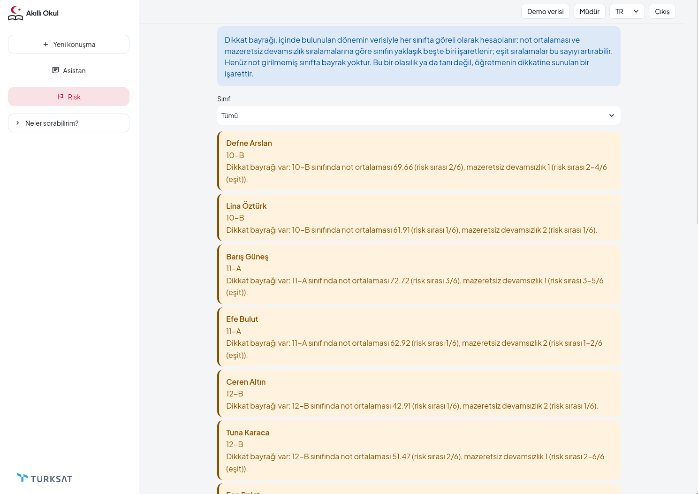

Neden model değil de kural? Araştırma bölümü tam olarak bunu sınıyor.

## Araştırma: kural ve model

Okul demo verisi sentetik olduğu için soru açık veri üzerinde çalışıldı.

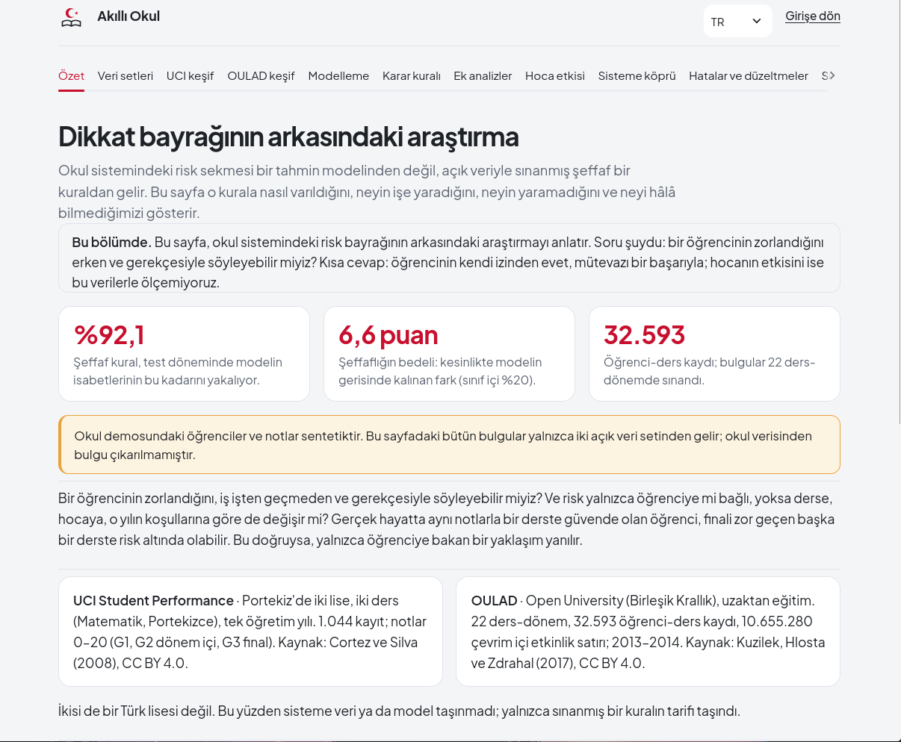

**UCI Student Performance** (Portekiz'de iki ortaöğretim okulu, matematik ve Portekizce derslerinde 1.044 öğrenci kaydı) keşif amaçlı kullanıldı. Uygulamayı şekillendiren bir sonuç: Devamsızlık tek başına final notu için zayıf bir sinyal (Spearman ρ tüm veride −0,11; final notu 0 olan 53 öğrenci çıkarıldığında −0,24. Bu öğrenciler düşük not alanlardan çok bırakmış öğrencilere benziyor).

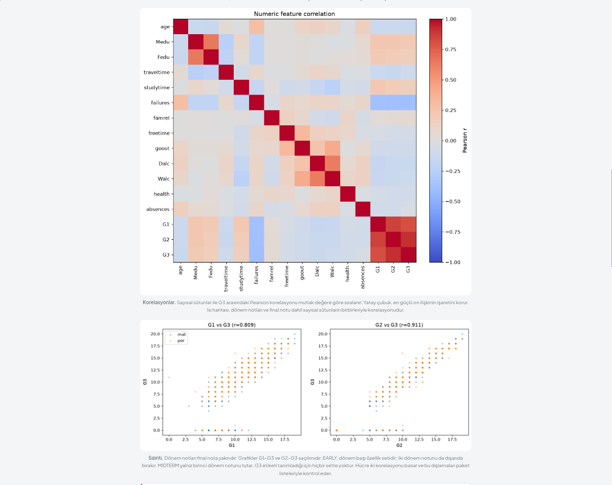

**OULAD** (Open University Learning Analytics Dataset; 22 modül-dönem, öğrenme platformunda yaklaşık 10,6 milyon etkinlik satırı) modelleme için kullanıldı. Kurulum:

- Tahmin dersin **60. gününde** yapılıyor ve yalnızca o güne kadar bilinenleri kullanıyor: ödev puanları, teslim edilmeyen ödevler, platform etkinliği ve ders geçmişi.
- Dersi başarısız bitiren ya da bırakan öğrenci pozitif sayılıyor. 60. günden önce kaydını silmiş öğrenciler dışarıda bırakılıyor.
- Bölmeler zamana göre: 2013J ile eğitim, 2014B ile doğrulama ve 2014J üzerinde **bir kez** test.
- Modeller: lojistik regresyon ve histogram gradient boosting, beş öznitelik seti üzerinde.

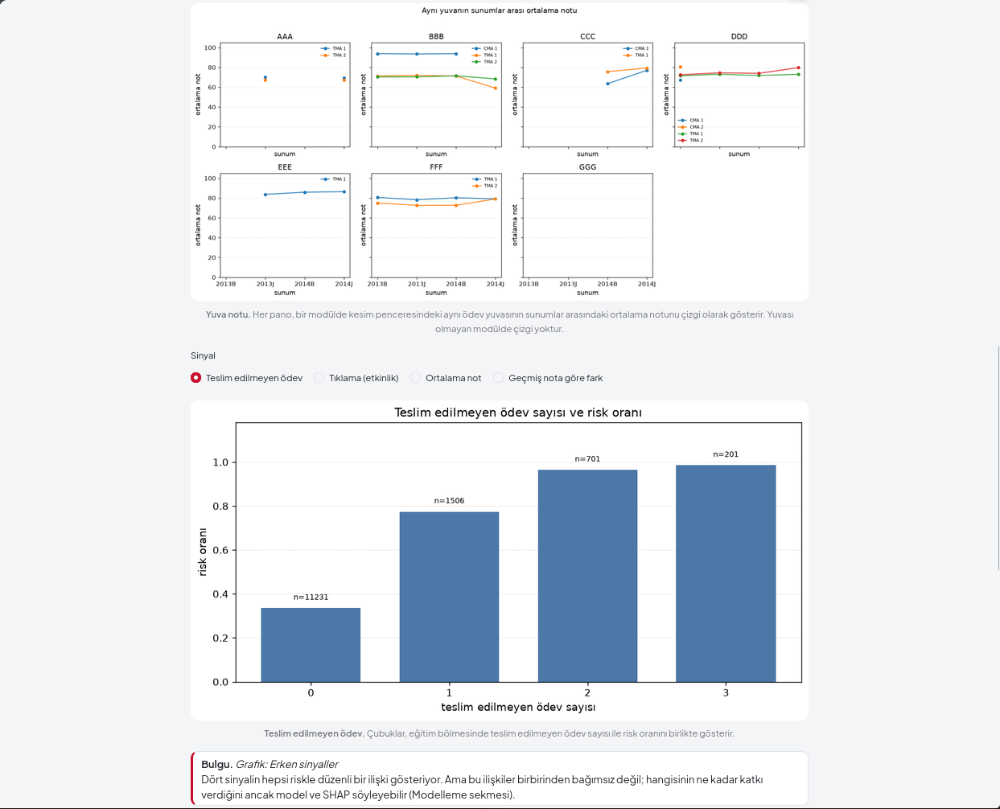

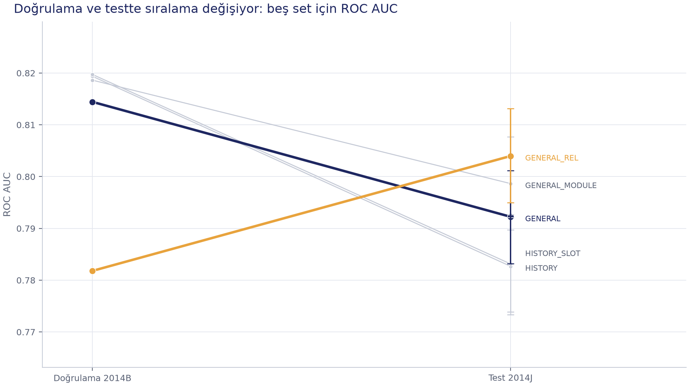

*Doğrulamada en iyi olan öznitelik seti testte en iyi değildi. Modeli yalnızca doğrulama skoruna bakarak seçmek burada yanıltıcı olurdu; raporun beş setin hepsini göstermesinin nedeni bu.*

Ana karşılaştırma sabit kuralı ve modeli aynı kapasiteye koyuyor: İkisi de 2014J test döneminde her modülün içinde öğrencilerin %20'sini işaretliyor.

| Yöntem | Öğrenci | İşaretlenen | Doğru işaret | Kesinlik |
| --- | ---: | ---: | ---: | ---: |
| Sabit kural (teslim edilmeyen ödev, puan, aktif gün) | 8.140 | 1.630 | 1.283 | 0,787 |
| Gradient boosting modeli | 8.140 | 1.630 | 1.352 | 0,829 |

Model daha iyi ama fark büyük değil: yaklaşık 4 puan, yani 1.630 işaretten 69'u daha doğru. Gradient boosting modelinin genel test ROC AUC değeri 0,792 (%95 GA 0,783–0,801). Sonuçlar mütevazı ve rapor onları öyle sunuyor.

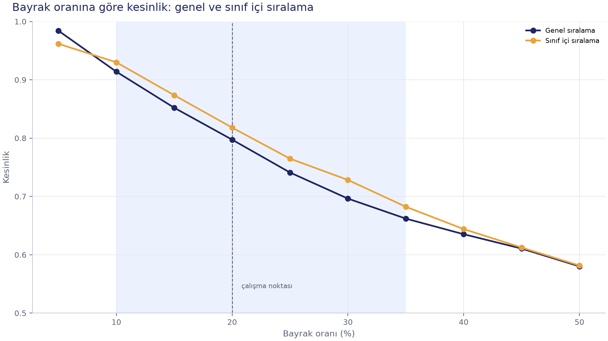

*%20 çalışma noktasında öğrencileri kendi sınıfları içinde sıralamak, herkesi birlikte sıralamaktan biraz daha kesin sonuç veriyor. Bu da uygulamadaki bayrağın sınıf içi tasarımını destekliyor.*

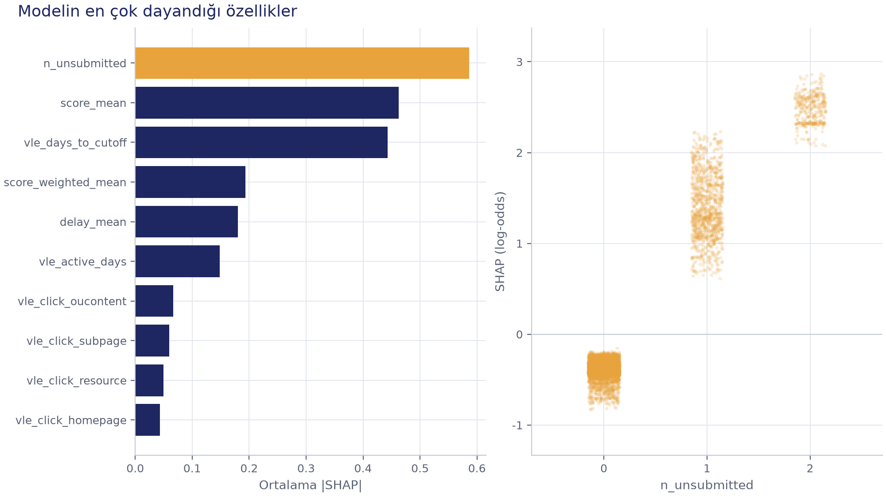

*En güçlü öznitelik teslim edilmeyen ödev sayısı. SHAP modelin neyi kullandığını gösterir, başarısızlığın nedenini değil.*

Ana çalışmadan sonra, beklentileri önceden yazılmış dört ek analiz yaptım; beklenti dosyaları koşulardan önce md5 ile kayda geçirildi (`docs/on_kayit_md5.txt`). On beklentiden 5'i tuttu, 3'ü tutmadı, 2'si belirsiz kaldı. En ilginç sonuç başlangıçtaki tahminimin tersiydi: 60. günde, dersi sürdürüp başarısız olacak öğrenciyi bulmak, dersi bırakacak öğrenciyi bulmaktan iki dönemde de yaklaşık 0,04 ROC AUC daha kolay. Not ve teslim bilgisi birlikte, hiç etkinlik verisi olmadan tam modelin 0,011–0,017 ROC AUC gerisinde kalıyor. Öğrenme platformu olmayan bir okul için bu önemli.

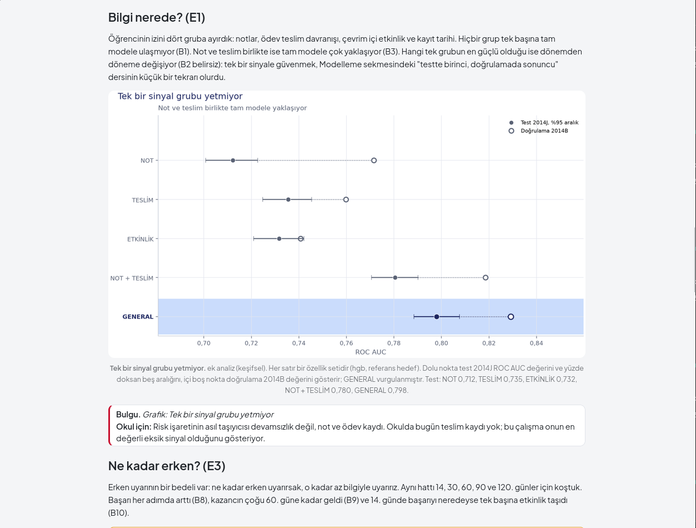

Okul uygulaması açısından anlamı: Okul verisinde şu an teslim edilmeyen ödev kaydı yok ve çalışma bunun eklenebilecek en değerli sinyal olduğunu gösteriyor.

Tüm figürlerin Türkçe ve İngilizce hâlleri ve çalışma sırasında bulunup düzeltilen hataları anlatan bölümle birlikte raporun tamamı [araştırma raporu sayfasında](https://smartschoolassistant.com/?sayfa=arastirma). Notebook'lar `notebooks/` klasöründe (Türkçe ve `_eng` sürümleri), HTML çıktıları `notebooks/html/` altında.

## Kullanılan teknolojiler

| Katman | Araçlar |
| --- | --- |
| Backend | Python 3.14, FastAPI, SQLAlchemy 2, Pydantic Settings, python-jose (JWT), passlib + bcrypt |
| SQL denetimi | sqlglot |
| Veritabanı | PostgreSQL 18, satır düzeyi güvenlik, `SECURITY DEFINER` fonksiyonlar |
| Asistan | Araç kullanımıyla Anthropic API |
| Arayüz | Streamlit, özel CSS teması |
| Veri bilimi | pandas, NumPy, scikit-learn, SHAP, matplotlib, pyarrow, Jupyter |
| Yayına alma | Docker Compose, Caddy (otomatik HTTPS), Contabo VPS, Cloudflare DNS |
| Test | pytest |

## Proje yapısı

```text
.
├── backend/
│   ├── app/
│   │   ├── api/          # /login, /query, /assistant/examples, /risk
│   │   ├── core/         # JWT, SQL denetleyici, RLS bağlamı, istek sınırlayıcı, log
│   │   ├── models/       # SQLAlchemy modelleri
│   │   └── services/     # asistan döngüsü, dikkat bayrağı, şema özeti, takvim
│   └── tests/
├── frontend/
│   ├── app.py            # giriş, asistan, risk sayfası, yönlendirme
│   ├── arastirma.py      # araştırma raporu sayfası
│   ├── haftalik.py       # haftalık raporlar sayfası
│   ├── i18n.py           # Türkçe / İngilizce metinler
│   ├── assets/           # logolar, araştırma figürleri, haftalık slaytlar
│   └── tests/
├── database/
│   ├── init_db.py        # tabloları oluşturur
│   ├── bootstrap_roles.py# school_app rolü, yetkiler, temel politikalar
│   ├── enable_rls.py     # RLS politikaları ve SECURITY DEFINER fonksiyonlar
│   ├── seed_mock.py      # sentetik okul verisini yükler
│   ├── mock_data.json
│   └── ref/              # referans veritabanından alınan şema ve roller
├── data_science/
│   ├── download.py, eda.py, features.py    # UCI bölümü
│   └── oulad/            # OULAD yükleme, öznitelikler, modeller, kural, SHAP, ek analizler, figürler
├── notebooks/            # 01 UCI keşif, 02 OULAD keşif, 03 OULAD model (TR + EN)
├── scripts/              # araştırma paketi, haftalık slayt dönüştürme, sentetik veri üretici
├── eval/                 # asistanın uçtan uca değerlendirmesi
├── config/settings.py
├── docs/                 # yayına alma, güvenlik, araştırma belirtimleri, ön kayıt dosyaları
├── tests/                # veri bilimi testleri
├── Dockerfile
├── docker-compose.yml
├── Caddyfile
└── requirements.lock.txt
```

## Yerelde çalıştırma

Python 3.14 ve PostgreSQL 18 gerekiyor. Anthropic API anahtarı yalnızca asistan için gerekli; giriş, risk sayfası ve araştırma sayfası anahtarsız da çalışıyor.

```bash
git clone https://github.com/beraerr/smart_school_assistant.git
cd smart_school_assistant

python3.14 -m venv .venv
.venv/bin/python -m pip install -r requirements.lock.txt

cp .env.example .env
# .env'i doldurun: SECRET_KEY, DATABASE_URL (süper kullanıcı), APP_DATABASE_URL (school_app),
# ANTHROPIC_API_KEY, LLM_MODEL. Demoyla aynı olması için isteğe bağlı DEMO_TODAY=2026-11-09.
```

Boş bir veritabanı oluşturup `DATABASE_URL`'i ona yönlendirin, ardından kurulum betiklerini bu sırayla çalıştırın:

```bash
.venv/bin/python database/init_db.py
.venv/bin/python database/bootstrap_roles.py
.venv/bin/python database/enable_rls.py
.venv/bin/python database/seed_mock.py
```

İlk üçü güvenle yeniden çalıştırılabilir. `seed_mock.py` ise her çalıştığında tabloları boşaltıp yeniden yükler.

Backend'i ve arayüzü iki ayrı terminalde başlatın:

```bash
.venv/bin/python -m uvicorn backend.app.main:app --port 8000
.venv/bin/python -m streamlit run frontend/app.py
```

Uygulama `http://localhost:8501` adresinde açılır.

### Demo hesapları

Aynı hesaplar canlı demoda da çalışıyor. Yalnızca demo içindir ve bilerek herkese açıktır.

| Rol | Kullanıcı adı | Parola | Gördüğü |
| --- | --- | --- | --- |
| Müdür | `principal` | `admin123` | Tüm okul |
| Sınıf öğretmeni | `teacher1` | `teacher123` | 9-A sınıfı |
| Sınıf öğretmeni | `teacher2` | `teacher123` | 10-B sınıfı |
| Veli | `parent1` | `parent123` | Kendi çocuğu |
| Öğrenci | `student1` | `student123` | Kendi kayıtları |

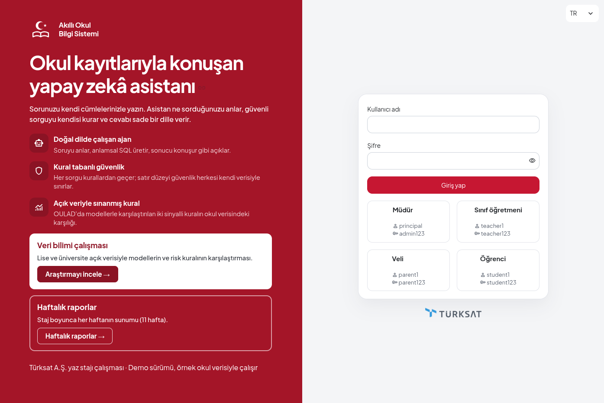

## Araştırma hattını çalıştırma

Ham veri setleri repoda yok (yalnızca OULAD etkinlik dosyası yaklaşık 450 MB). İndirme betikleri verileri UCI deposundan çekiyor ve kayıtlı SHA-256 değerleriyle karşılaştırıyor.

```bash
# UCI Student Performance
.venv/bin/python -m data_science.download
.venv/bin/python -m data_science.eda

# OULAD: indirme, günlük etkinlik tablosu, 60. gün öznitelikleri, modeller, kural, SHAP
.venv/bin/python -m data_science.oulad.download
.venv/bin/python -m data_science.oulad.vle
.venv/bin/python -m data_science.oulad.dataset
.venv/bin/python -m data_science.oulad.model
.venv/bin/python -m data_science.oulad.rule
.venv/bin/python -m data_science.oulad.explain
.venv/bin/python -m data_science.oulad.ek          # ek analizler (üçüncüsü için --e3)
.venv/bin/python -m data_science.oulad.figures

# Araştırma sayfasının okuduğu paketi yeniden oluştur
.venv/bin/python scripts/arastirma_paketi.py
```

Araştırma sayfası yalnızca `frontend/assets/arastirma/arastirma.json` dosyasını ve figürleri okuyor. Sayfadaki her sayı bu paketten geliyor; sayfa metninde elle yazılmış rakam yok ve testler bunu kontrol ediyor.

## Testler

```bash
.venv/bin/python -m pytest -q
```

1.300'ün biraz üzerinde test var. SQL denetleyiciyi, satır düzeyi güvenliği, asistan döngüsünü (sahte bir modelle; API çağrısı yapılmıyor), dayanak kontrolünü, dikkat bayrağını, araştırma paketini ve iki arayüz sayfasını kapsıyorlar.

Bazı backend testleri yukarıdaki kurulumdaki yerel PostgreSQL veritabanında çalışıyor. Ham araştırma verisi gerektiren testler, veri diskte yoksa atlanıyor.

## Yayına alma

Canlı demo bir Contabo VPS üzerinde Docker Compose ile çalışıyor:

| Servis | Görevi |
| --- | --- |
| `db` | PostgreSQL 18.6, veri adlandırılmış bir volume'de, dışa kapalı |
| `init` | Tek seferlik iş (`init` profili): tablolar, roller, RLS, seed |
| `backend` | Uvicorn, sağlık kontrollü |
| `frontend` | Streamlit |
| `caddy` | Dışa açık tek servis, 80/443 portları, otomatik sertifika |

`.env` dosyası yalnızca sunucuda var; hem imajın hem reponun dışında tutuluyor. Adım adım kurulum [`docs/DEPLOY.md`](docs/DEPLOY.md) dosyasında.

Demoda tarih 9 Kasım 2026'ya sabitlendi (`DEMO_TODAY`); böylece sentetik dönem verisi ve "bu dönem" cevapları tutarlı kalıyor.

## Bilinen sınırlamalar

- İstek sınırları süreç belleğinde tutuluyor: worker'lar arasında paylaşılmıyor ve yeniden başlatmada sıfırlanıyor.
- Demo herkese açık; herkes müdür dahil her rolle giriş yapabiliyor.
- Asistan soruyu, şema özetini ve sorgu sonuçlarını harici bir API'ye gönderiyor. Gerçek öğrenci verisiyle kullanılmadan önce KVKK / GDPR değerlendirmesi gerekir.
- Dikkat bayrağı yalnızca not ve devamsızlığı kullanıyor. Araştırma teslim edilmeyen ödevin daha güçlü bir sinyal olacağını gösteriyor, ama okul veri modelinde henüz böyle bir kayıt yok.
- Araştırma sonuçları İngiltere'de bir uzaktan eğitim üniversitesinden ve Portekiz'deki ortaöğretim okullarından geliyor. Bu veri setlerinde neyin işe yaradığını gösteriyorlar; bir Türk okulunda neyin işe yarayacağını değil.

## Veri kaynakları

- P. Cortez ve A. Silva, *Using Data Mining to Predict Secondary School Student Performance*, 2008. [UCI Student Performance veri seti](https://archive.ics.uci.edu/dataset/320/student+performance), CC BY 4.0.
- J. Kuzilek, M. Hlosta ve Z. Zdrahal, *Open University Learning Analytics dataset*, Scientific Data 4, 2017. [UCI'da OULAD](https://archive.ics.uci.edu/dataset/349/open+university+learning+analytics+dataset), CC BY 4.0.

---

Ensar Bera Ergin · Bilgisayar Bilimleri, Polish-Japanese Academy of Information Technology (PJAIT), Varşova · [GitHub](https://github.com/beraerr)
